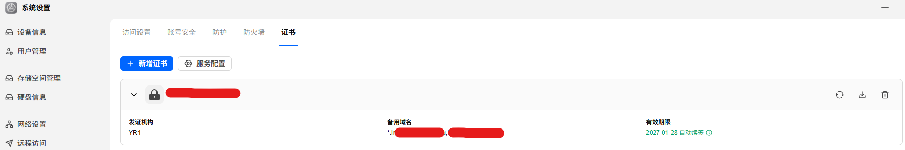

# fnOS 多域名证书申请（一张证书覆盖多域名 + 通配符）

> **仅供个人学习与技术研究使用。** 本项目基于对 fnOS 官方 API 协议的分析整理而成，
> 请仅在你拥有合法使用权的设备上使用；使用本项目产生的一切后果由使用者自行承担。

> 完整背景、原理、协议细节、踩坑记录见 **[NOTES.md](NOTES.md)**。
> 本文档是「现在该怎么做」的快速上手。



## 你要做的事（一句话）

在 fnOS NAS 上跑一个 Python 脚本，用**密码自动登录**，一张证书签出多个域名（含通配符），
之后由 fnOS 自动续签。**全程不需要操作浏览器、不需要手动申请。**

## 快速开始（唯一推荐方式）

```bash
# 1. 在 NAS 上（SSH 进去，或本机执行）
export FNOS_USER='你的用户名'
export FNOS_PASS='你的网页登录密码'

# 2. 先测连通（会真实登录一次 + 列出所有证书，只读不写）
python3 03-apply-multidomain-cert.py --test

# 3. 正式申请多域名证书
python3 03-apply-multidomain-cert.py \
  -d "example.com,*.example.com,www.example.com" \
  -r 1
```

参数：

| 参数 | 含义 | 默认 |
|---|---|---|
| `-d` / `--domains` | 逗号分隔域名列表（可含通配符 `*.x`） | 必填 |
| `-r` / `--related-ddns-id` | DDNS 记录 id（提供 DNS-01 解析商凭证） | 1 |
| `-s` / `--server` | WS 地址，留空自动探测 | 本机 HTTPS 端口（`FNOS_WS_PORT` 可指定，默认 5667） |
| `--desc` | 证书备注 | multidomain-cert |
| `--test` | 只登录 + 列证书，不做写操作 | — |

依赖：`python3`（标准库）+ `openssl`（fnOS 自带）。

### 如果 NAS 开了「访问码 / 访问保护」

「访问码」是 nginx 层的拦截：连 WebSocket 握手都会被 `401 Unauthorized` 拒掉
（响应头带 `X-Trim-Safe-Code-Challenge: 1`），脚本的密码登录根本没机会执行。
表现为报错：

```
WS 握手失败: HTTP/1.1 401 Unauthorized
```

两种解法，任选其一：

```bash
# a) 把访问码也交给脚本（推荐，保持全自动）
export FNOS_ACCESS_CODE='你的访问码'
```

脚本会先请求 `/access_code_verify` 换取会话 Cookie，再带着 Cookie 建立连接。

```text
# b) 关闭访问码：fnOS 网页 → 安全性 → 访问设置 → 访问码 → 关闭
```

> 注意区分两种失败：**HTTP 401/403**（握手阶段被网关拦，多半是访问码）
> 与 **`errno 65534` 验签失败**（已连上，但会话没绑定，见下方的 Cookie 方式）。

### 如果账号开了「双重验证（2FA）」

开了 2FA 后，`user.login` 只返回 `accessToken`，不返回签帧用的 `secret`，
脚本会提示需要验证码。补一个环境变量即可（6 位数字，30 秒有效）：

```bash
export FNOS_2FA_CODE='验证器 App 里的 6 位码'
python3 03-apply-multidomain-cert.py --test
```

脚本一次跑完：登录 → 提交验证码（`user.2fa.loginVerify`）→ 拿 `secret` → 调接口。
验证码错或过期会明确报 `135168`，不会影响账号。

> 因为验证码有时效，**不适合放进定时任务**。好消息是：证书签发后由 fnOS
> 自己按 `renewal:1` 自动续签，本脚本只在「要新签一张证书」时才需要跑一次，
> 所以一次 2FA 并不影响长期无人值守。

### 申请完成后

网页「安全性 → 证书 → 服务配置」把新证书绑定到反向代理等服务，
确认无服务绑定后可删旧单域名证书。

## 备选：Cookie + Secret（仅当不想用密码登录时）

```bash
export FNOS_SECRET='<DevTools → Application → Local Storage → fnos-Secret>'
export FNOS_COOKIE='<DevTools → Network → 任意请求 → Cookie 请求头整行>'
python3 03-apply-multidomain-cert.py --test
```

> 说明：这个备选方式需要从浏览器手动取凭据，且 Cookie 会过期，不如密码登录省事。

## 其余文件是干什么的

| 文件 | 用途 |
|---|---|
| `03-apply-multidomain-cert.py` | **你现在唯一需要跑的脚本**（密码登录 + 一键申请） |
| `NOTES.md` | 完整背景、原理、协议细节、踩坑记录 |
| `archive/` | **旧方案存档**（已弃用）：浏览器 Cookie 方案 + Windows 种子证书生成器，见 `archive/README.md` |

## 关键 API 与协议（摘要）

- 核心配方：`cert.upload`（导入自签多 SAN 种子证书）→ `cert.replace`（补 `renewal:1 + relatedDDNSId`）
  → `cert.renew`（触发 fnOS 自己的 ACME 按全部 SAN 走 DNS-01 签真证书）
- WS 帧签名：`base64(HMAC-SHA256(json, secret)) + json`
- **坑**：种子证书必须 `CA:FALSE`（`openssl req -x509` 默认 CA:TRUE 会导致 renew 报错）
- 完整错误码表、协议细节、全部踩坑记录 → 见 [NOTES.md](NOTES.md)
